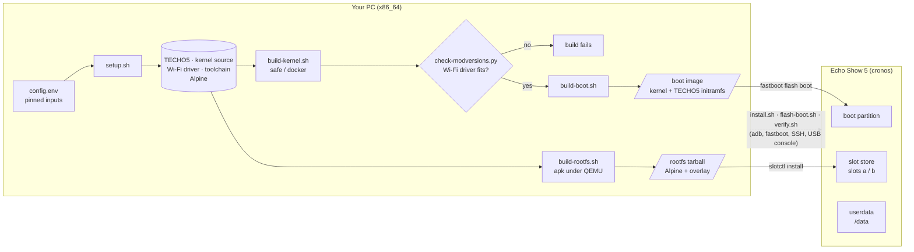
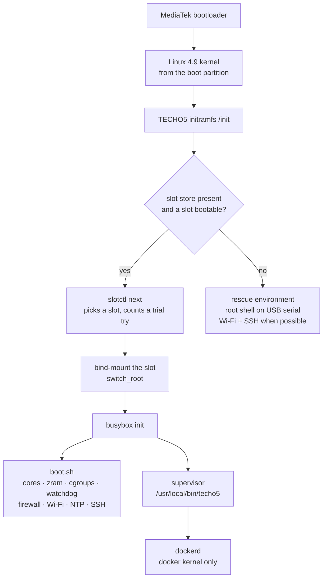
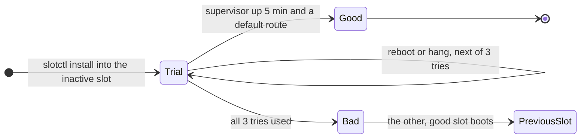
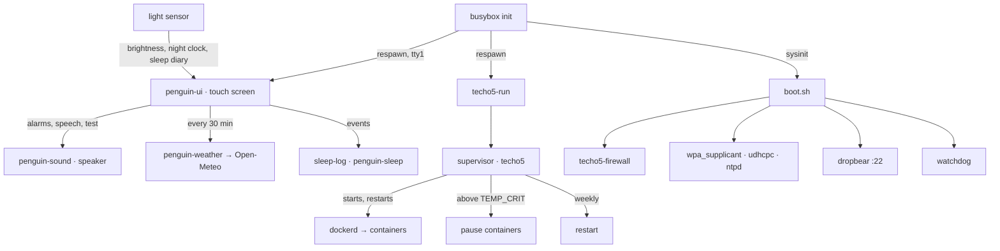

# echo-penguin 🐧

**Turn an Amazon Echo Show 5 (2nd gen) into a tiny, always-on Linux server.**

echo-penguin replaces Android on the Echo Show 5 2nd gen (codename `cronos`) with
[Alpine Linux](https://alpinelinux.org/): you get Wi-Fi, SSH with keys only, Docker, a simple touch
screen with a clock, alarms and system information that dims itself when the room goes dark, the
speaker, and a system built to run 24/7
without anyone touching it. It is built on top of the
[TECHO5](https://github.com/HuskerMinion/techo5) boot chain.

[](LICENSE)
-orange)


> [!WARNING]
> Installing **erases Android (LineageOS)** from the unit. It requires an Echo Show 5 2nd gen that
> is unlocked and running LineageOS 18.1: **[INSTALL.md](INSTALL.md) walks through all of it, from a
> locked unit.** Everything here is at your own risk. This project is not affiliated with or
> endorsed by Amazon.

## Contents

- [What you get](#what-you-get)
- [Goals and non-goals](#goals-and-non-goals)
- [Quick start](#quick-start)
- [Using the Echo](#using-the-echo) ([Alarms](#alarms), [Waking up](#waking-up), [Weather and speech](#weather-and-speech), [Night clock](#night-clock), [Sleep diary](#sleep-diary), [Automatic brightness](#automatic-brightness), [Securing SSH](#securing-ssh))
- [How it works](#how-it-works)
- [Maintenance](#maintenance)
- [Troubleshooting](#troubleshooting)
- [Repository layout](#repository-layout)
- [Status and next steps](#status-and-next-steps)
- [Contributing](#contributing)
- [References](#references)
- [License](#license)

## What you get

| | |
|---|---|
| **Hardware** | MediaTek MT8163, 4x Cortex-A53 up to 1.3 GHz, ~1 GB RAM (+480 MB zram swap), 7.3 GiB eMMC, MT7668 Wi-Fi (2.4/5 GHz) |
| **System** | Alpine Linux 3.24 (armv7 userland), busybox init, read-only root, state on `/data` |
| **Access** | Wi-Fi + SSH (Dropbear, **keys only**, optionally limited to the computers you list, can be turned off); a root console over USB as a fallback |
| **Containers** | Docker (overlay2, data on `/data/docker`) on the `docker` kernel |
| **Reliability** | hardware watchdog, temperature guard, weekly restart, rotated logs, A/B system slots with automatic rollback |
| **Security** | firewall closes everything on Wi-Fi except SSH and the ports you choose |
| **Screen** | a touch interface (clock, up to eight alarms with a beep or your own music, a sunrise and a rising volume before the alarm, stopwatch, timer, system, network & SSH, installed software, logs, brightness/volume); the weather; a dim night clock; a sleep diary; brightness that follows the room's light; kernel and boot messages while it boots |
| **Sound** | the built-in speaker (`penguin-sound`: beeps, WAV and MP3, speech with espeak-ng), the volume buttons |

Typical uses: a home lab node, a small self-hosted service, a Docker host for lightweight
containers, an always-on SSH jump box.

## Goals and non-goals

**Goals**

- Run plain Linux on the Echo Show 5 2nd gen, **without Android**.
- Be **reachable without touching it**: Wi-Fi and SSH come up on every boot on their own; the touch
  screen is there for a glance (time, address, logs), never required.
- Run **24/7 unattended**, and recover on its own from bad updates, hangs and overheating.
- Be **reproducible**: every input is pinned in [config.env](config.env), and the build refuses to
  produce an image that would boot without Wi-Fi.
- Keep a **way back** to LineageOS or Fire OS.

**Non-goals**

- What runs on top (your containers and services): that is up to you.
- A desktop, voice assistant, microphones, camera or Bluetooth. The screen is a small text UI, not a
  graphical environment.
- Other Echo models. TECHO5 supports more devices; echo-penguin only targets `cronos`.

## Quick start

Starting from a locked unit, or unsure about any step: follow **[INSTALL.md](INSTALL.md)**. This
section is the short version for a unit that already runs LineageOS.

### 1. What you need

**The Echo**

- An Echo Show 5 **2nd gen** (2021, `cronos`), unlocked, rooted and running
  **LineageOS 18.1** (the XDA guides in [References](#references)).
- In LineageOS: Wi-Fi connected, **USB debugging** and **Rooted debugging** on.
- A USB cable to your PC.

**The PC** (Linux x86_64)

- `git`, `python3` with `brotli`, `make`, `gcc`, `bc`, `curl`, `debugfs` (e2fsprogs), `unshare`,
  Docker, `adb` and `fastboot`.
- QEMU user emulation for armv7, once per PC boot (package install scripts run inside the armv7
  rootfs):

  ```bash
  sudo apt install qemu-user-static binfmt-support            # permanent
  # or, without apt (lasts until the PC reboots):
  docker run --privileged --rm tonistiigi/binfmt:qemu-v9.2.2 --install arm
  ```

- The LineageOS zip `lineage-18.1-20260904-UNOFFICIAL-cronos.zip` (the vendor Wi-Fi module is read
  from it). Point `LINEAGE_ZIP=` at it; by default it is looked for in `../echo-show/`.
- An SSH key: `~/.ssh/techo5.pub`, else `~/.ssh/id_ed25519.pub`, or set `SSH_PUB=`.

No root is needed for the build.

### 2. Build

```bash
git clone <this repository> echo-penguin && cd echo-penguin
scripts/build-all.sh
```

This fetches every input at its pinned commit, builds both kernels, both boot images and the root
filesystem. Everything downloaded or generated goes to `build/` (git-ignored; override with
`PENGUIN_BUILD=`). The results are in `build/work/out/`.

### 3. Install

```bash
scripts/install.sh safe --dry-run     # checks everything, writes nothing
scripts/install.sh safe               # asks once before erasing LineageOS
```

The installer backs up the LineageOS boot image, flashes echo-penguin, creates the slot store,
installs the system into slot `a`, copies your SSH key and follows the first boot. Wi-Fi uses the
network LineageOS had saved (or pass `--wifi <network>`).

> [!TIP]
> Start with the **safe** kernel: it uses the stock Wi-Fi driver and is the lowest-risk first
> boot. Move to the **docker** kernel afterwards (step 5).

### 4. Verify

```bash
HOST=<echo-ip> scripts/verify.sh
```

Each check prints `PASS`, `FAIL` or `WARN`: key-only SSH, slot state, Wi-Fi, cores, memory, zram,
watchdog, temperature, Docker and closed ports. The checks that need time (24 h, 72 h) or hands on
the unit (power cut, rollback) are printed as a checklist at the end.

### 5. Enable Docker

```bash
HOST=<echo-ip> scripts/flash-boot.sh docker
```

If the new kernel does not come back on SSH within 5 minutes, the previous one is flashed back
automatically.

## Using the Echo

```bash
ssh -i ~/.ssh/techo5 root@<echo-ip>
```

| Command | What it does |
|---|---|
| `penguin status` | kernel, services, containers, temperature, memory, disk, slots |
| `penguin logs [supervisor\|docker\|boot\|firewall] [-f]` | show (or follow) a log |
| `penguin settings` | effective settings |
| `penguin set KEY VALUE` | change a setting (kept across updates) |
| `penguin firewall` | re-apply the firewall after changing `LAN_PORTS` or `DOCKER_LAN` |
| `penguin restart` | restart the supervisor (containers keep running) |
| `slotctl status` | which system slot is active, and its state |
| `penguin ssh` | SSH on/off, the allowed computers, the authorized keys and their fingerprints |
| `penguin ssh allow here` / `deny ADDR` / `allow any` | add this computer to the SSH allow list, remove one, clear the list |
| `penguin ssh on` / `off` | start or stop SSH |
| `penguin-weather set CITY` / `show` / `update` | choose the weather's place by name, show the forecast, fetch it now |
| `penguin-sleep nights` | the sleep diary's last nights and their average |
| `penguin-sound say TEXT` | say a text (espeak-ng, voice `SPEAK_VOICE`) |
| `penguin cleanup [--slot] [--yes]` | list what is no longer needed (installed rootfs tarballs, test files, stopped containers outside compose, untagged images); `--yes` removes it, `--slot` adds the inactive slot |

**Settings.** Defaults live in [/etc/penguin/defaults.conf](rootfs/etc/penguin/defaults.conf);
your overrides go to `/data/penguin/settings.conf`. The most useful ones:

| Setting | Default | Meaning |
|---|---|---|
| `SSH` | `on` | `off` stops SSH and closes port 22 (`penguin ssh on\|off`, or the screen) |
| `SSH_ALLOW` | *(empty)* | the only computers allowed to connect: MAC and/or IP addresses (`penguin ssh allow here`) |
| `LAN_PORTS` | *(empty)* | extra TCP ports open on Wi-Fi, e.g. `"80 443"` |
| `DOCKER_LAN` | `0` | `1` lets containers' published ports be reached from Wi-Fi |
| `DOCKER` | `auto` | start Docker when the kernel supports it, or `off` |
| `BACKLIGHT` | `90` | screen brightness 0–255 (`0` = off); with automatic brightness, the level in a lit room |
| `AUTO_BRIGHTNESS` | `1` | the screen follows the room's light ([Automatic brightness](#automatic-brightness)); `0` = fixed at `BACKLIGHT` |
| `BACKLIGHT_DARK` | `10` | with automatic brightness, the level in a dark room (1–255) |
| `SCREEN_UI` | `1` | the touch interface; `0` = the screen shows the log console only |
| `SCREEN_MIRROR` | `1` | show interactive SSH/USB sessions on the screen's log console |
| `VOLUME` | `50` | speaker volume 0–100 |
| `WAKE_LIGHT` / `WAKE_RAMP` | `10` / `60` | minutes of sunrise before an alarm; seconds the alarm's volume takes to climb (`0` = off) ([Waking up](#waking-up)) |
| `WAKE_VOLUME_START` | `80` | where the alarm's volume starts, in percent of `VOLUME` (`100` = no climb) |
| `NIGHT_CLOCK` / `NIGHT_COLOR` | `auto` / `red` | a dim clock in the dark ([Night clock](#night-clock)): `auto`, `on`, `off`; `red` or `amber` |
| `WEATHER_LAT` / `WEATHER_LON` / `WEATHER_PLACE` | *(empty)* | the weather's place (`penguin-weather set CITY`); empty = no weather |
| `SPEAK_ALARM` / `SPEAK_VOICE` | `1` / `en` | say the time and the weather after an alarm; the espeak-ng voice (`pt-br`, `es`, ...) |
| `SPEAK_ENGINE` / `PIPER_VOICE` | `espeak` / `pt_BR-faber-medium` | `piper`: the alarm's greeting in Piper's natural voice, rendered ahead ([Weather and speech](#weather-and-speech)) |
| `SLEEP_LOG` | `1` | record the [sleep diary](#sleep-diary); `0` = off |
| `TEMP_CRIT` | `85` | °C at which running containers are paused |
| `WEEKLY_REBOOT_DAY` / `_HOUR` | `0` / `4` | weekly restart (Sunday 04:00); empty = never |

**The screen.** The home screen shows the time, the [weather](#weather-and-speech) and six buttons: **Logs** (kernel errors, the boot
log and every interactive SSH or USB-console session, live), **System**, **Network & SSH**,
**Clock** ([alarms](#alarms); a stopwatch; a timer), **Installed** and **Display & sound**
([brightness](#automatic-brightness), volume, screen off). `< Back` returns. Tapping the big clock
says the time and the weather. The volume buttons on top change the volume, or stop a ringing
alarm. The interface is [penguin-ui](rootfs/usr/local/bin/penguin-ui): plain text on
the kernel's framebuffer console, Python's standard library only.

**Sound.** `penguin-sound beep [Hz ms count]`, `penguin-sound play file.wav|file.mp3`,
`penguin-sound volume [0-100]`, `penguin-sound say [-v voice] text`. It holds the workaround the MediaTek playback driver needs (without
it, the first sound panics the kernel), so use it rather than `aplay` directly. One sound plays at a
time: another one asked for meanwhile is skipped. SIGTERM stops a playback cleanly.

### Alarms

Clock > Alarm lists the alarms, up to eight, in time order. Tap `+ Add an alarm`, or an alarm to
change it: its time, `Alarm is ON/OFF`, `Repeat:` (every day, Monday to Friday, Saturday and Sunday,
or once, after which it turns itself off) and `Sound:`. `Delete` asks for a second tap. The `ON`/`off`
box next to each alarm switches it without opening it. The home screen shows the next alarm due.
Alarms that fall on the same minute ring once. A ringing alarm stops with a tap
anywhere or the volume buttons; nobody answering, it stops by itself after ten minutes.

The alarms are kept in `/data/penguin/alarms.json`, which the screen reloads by itself when it
changes, so they can also be edited from a PC (the [Echo Manager](https://github.com/matheusinfo/echo-penguin-manager) desktop app does). Up to
v0.2.8 there was a single alarm, in `alarm.json`: it becomes the first alarm of the list, and the old
file is left alone, so a rollback to an older slot still finds its alarm.

**Music.** An alarm can play a track instead of the beep. Tracks live in `/data/penguin/music/`, so
they survive system updates: `.mp3` files, or `.wav` files recorded at 48 kHz, 16-bit, stereo (the
extension in any case), copied in over SSH:

```bash
ssh root@<ip> mkdir -p /data/penguin/music
scp 'My song.mp3' root@<ip>:/data/penguin/music/
```

An alarm's `Sound:` button lists the built-in beep and every track in the folder (ten per page; new
files show up without a restart). Tap one to choose it; `Play the chosen sound` previews it and
`Stop` ends the preview. When the alarm rings, the track plays from the start, over and over, until
you stop it, and the screen shows its name. If the track cannot play (the file is gone or broken, or
a WAV in another format: the speaker's driver mishandles converted audio, so `penguin-sound` refuses
it; convert it with `ffmpeg -i in.wav -ar 48000 -ac 2 out.wav`, or use MP3), the alarm beeps
instead: it never stays silent. The timer always beeps.

### Waking up

**Sunrise.** `WAKE_LIGHT` minutes before an alarm (default 10), a screen nobody has touched for 30 s
turns into a sky that goes from deep red through orange to a pale warm white, the time in the middle,
while the backlight climbs from `BACKLIGHT_DARK` to `BACKLIGHT`; it does so even after `Screen off`.
A tap brings the interface back for a while. The colours come from the console's own palette
(`ESC ] P`), set step by step and reset afterwards.

**Volume.** An alarm starts at `WAKE_VOLUME_START` percent of `VOLUME` (default 80) and climbs to
`VOLUME` over `WAKE_RAMP` seconds (default 60): with `VOLUME=50` it starts at 40. The volume scale is
the amplifier's, about 1.6 dB a point, so that start is some 16 dB under the full volume: soft, but
clearly heard. The volume goes back to `VOLUME` once the alarm stops.

**Then.** Once stopped by hand, the alarm is followed by the time and the weather, spoken
([Weather and speech](#weather-and-speech)); `SPEAK_ALARM=0` keeps it silent.

### Weather and speech

The weather comes from [Open-Meteo](https://open-meteo.com) (free, no account; data under
[CC BY 4.0](https://open-meteo.com/en/license)). Choose the place by name; the first match is used,
and `City, Region` or `City, CC` narrows the search:

```bash
penguin-weather find "Campinas"          # the candidates, with their coordinates
penguin-weather set "Campinas, Brazil"   # sets WEATHER_LAT, WEATHER_LON and WEATHER_PLACE, then fetches
penguin-weather show                     # what the screen knows
```

The screen fetches it shortly after boot and every 30 minutes (every 2 minutes after a failure, as
when the clock is not set yet), into `/run/penguin/weather.json`, and shows a line under the clock:
`18° partly cloudy · 15°/24° · rain likely from 15h`. Data older than three hours is not shown.

Two offline voices say it, both on the unit:

- **espeak-ng**, small and instant, with a robotic voice. `SPEAK_VOICE` picks it (`en`, `pt-br`, `es`,
  ...; `espeak-ng --voices` lists them). It answers a tap on the home screen's clock.
- **Piper**, a neural voice that sounds like a person reading, in Brazilian Portuguese
  (`pt_BR-faber-medium`). This CPU needs about 40 seconds for a sentence, so with
  `SPEAK_ENGINE=piper` the alarm's greeting is rendered in the background ten minutes before the
  alarm, and played the moment the alarm is stopped. It says when the alarm rang (`Bom dia. O
  despertador tocou às 5 e 30. Agora faz 18 graus, parcialmente nublado. Máxima de 24 graus.`); if it
  is not ready, espeak-ng says the time now instead. Other Piper voices (`.onnx` and `.onnx.json`
  from [piper-voices](https://huggingface.co/rhasspy/piper-voices)) can go in `/data/penguin/voices`
  and be chosen with `PIPER_VOICE`.

The sentence follows the voice's language (Portuguese for `pt*` voices, else English). From a shell:

```bash
penguin set SPEAK_ENGINE piper                              # the alarm's greeting in Piper's voice
penguin-sound say -e espeak "$(penguin-weather speech -e espeak)"
penguin-sound say -e piper "$(penguin-weather speech -e piper)"   # about 40 s before it speaks
```

Piper comes from Alpine's edge/testing repository, built against libraries newer than the
system's, so [build-piper.sh](scripts/build-piper.sh) copies it with every library it loads and their
own loader into `/usr/lib/piper` (about 21 MB, plus 63 MB of voice), apart from the system's libraries.
`PIPER=0 scripts/build-rootfs.sh` leaves it out.

### Night clock

Left alone for 30 s in a dark room, the screen shows only the time and the next alarm, in a dim red
(`NIGHT_COLOR=amber` for amber), on top of automatic brightness's dark level. A tap brings the
interface back (it presses nothing). The room counts as dark at a light reading of `LIGHT_DARK` or
less, and as lit again above twice that (at least `LIGHT_DARK` + 3). `NIGHT_CLOCK=on` shows it
whenever the screen is left alone, `off` never. A ringing alarm and the sunrise come first.

### Sleep diary

With `SLEEP_LOG=1`, the screen records when the room goes dark and lit again (once the change has
held for two minutes) and each alarm's ring and stop, in `/data/penguin/sleep-log.jsonl`.
[penguin-sleep](rootfs/usr/local/sbin/penguin-sleep) turns that into nights: from the lights off to
the alarm stopped by hand (or, with no alarm, to the lights on between 03:00 and 13:00). Short
interruptions (a light on for less than 30 minutes) do not split a night; a night when the alarm rang
unanswered (you were away) is left out. Clock > Sleep shows the last seven nights and their average:

```
Mon 09 Nov  lights off 22:41  up 05:12  6 h 31 min  ██████▌
```

`penguin-sleep nights [--days N] [--json]` prints them from a shell. The same tab shows the light
reading next to `LIGHT_DARK`: with the lights off, the reading must be `LIGHT_DARK` or less, or no
night starts; if it is not, raise `LIGHT_DARK` (`penguin set LIGHT_DARK 8`), which also tunes
automatic brightness and the night clock.

### Automatic brightness

With `AUTO_BRIGHTNESS=1` (the default), the screen follows the room's light: when the room goes
dark, it fades down to `BACKLIGHT_DARK` within a few seconds, and back up to `BACKLIGHT` when the
light comes back on. It reads the Echo's ambient light sensor once a second; a hand passing in front
of it changes nothing, and small changes in the room leave the level alone.

Display & sound shows the sensor's reading (`room light`, 0–4095) and sets both levels: with
automatic brightness on, the top `-`/`+` set the lit room's level and the second pair the dark
room's (each shown for a few seconds as you change it). `Auto brightness: ON/OFF` switches it. The
readings that count as dark and as lit are two more settings, `LIGHT_DARK` (default 3) and
`LIGHT_BRIGHT` (default 80); in between, the level moves along a log scale. If the screen stays too
bright with the lights off, look at the reading on that screen in the dark and set `LIGHT_DARK` a
little above it:

```bash
penguin set LIGHT_DARK 8        # the screen picks it up within seconds
```

`Screen off`, or a backlight set to 0 from SSH or Echo Manager, keeps the screen dark until a tap
or a ringing alarm brings it back.

### Securing SSH

Out of the box, SSH accepts **keys only**: no password works, not even root's. Dropbear runs with
`-s -g -T 3 -k` (no passwords, three attempts per connection, no remote port forwarding; `ssh -L`
tunnels still work), and the firewall limits new SSH connections per source (6 at once, then 6 a
minute). What is left open by default is *who may try*: any device on your Wi-Fi network reaches
port 22. To allow only the computers you choose:

```bash
# On each computer that should connect, once, over SSH:
ssh -i ~/.ssh/techo5 root@<echo-ip> penguin ssh allow here     # adds this computer's MAC
penguin ssh                                                     # the list, the keys, their fingerprints
penguin ssh deny aa:bb:cc:dd:ee:ff                              # remove one
penguin ssh allow any                                           # back to any device on the Wi-Fi
```

- **Each computer has its own key.** Add its public key as one line of
  `/data/misc/techo5/ssh/authorized_keys`; delete the line to revoke it. `penguin ssh` lists them.
- **MAC addresses are preferred** in `SSH_ALLOW`: an IP from DHCP can go to another device later.
  Use an IP address or a network (`192.168.1.0/24`, IPv6 too) only where there is no MAC to see,
  such as a VPN. A MAC can be spoofed by someone already on your Wi-Fi, so the list narrows who can
  try. The key is still what lets a computer in.
- `penguin ssh allow` and `deny` **refuse a list that would lock out** the session running them
  (`--force` overrides that).
- **Turning SSH off:** `penguin ssh off`, or **Network & SSH → SSH is ON** on the screen (tap twice).
  Port 22 closes and dropbear stops. Turn it back on from the same screen, or from the USB console
  (`ECHO_SERIAL=<serial> scripts/console.py 'penguin ssh on'`).
- **Locked out?** Network & SSH → **Allow any device** on the screen clears the list, and so does
  `penguin ssh allow any` on the USB console.
- Not covered by this: the **USB console** is a root shell for whoever has the unit and a cable in
  hand (physical access wins anyway). The **rescue environment**, which only runs after a failed
  boot, comes from TECHO5's boot image: it starts SSH with the same keys and without the firewall.

**Reaching a container.** Published ports are closed on Wi-Fi by default; use an SSH tunnel:

```bash
ssh -i ~/.ssh/techo5 -L 8080:localhost:8080 root@<echo-ip>   # then open http://localhost:8080
```

Or open them on the LAN: `penguin set DOCKER_LAN 1 && penguin firewall`.

> [!NOTE]
> The userland is 32-bit ARM, so Docker runs `linux/arm/v7` images. Keep RAM in mind: about
> 600 MB is available to your workloads.

## How it works

### The big picture



The repository holds only configuration, scripts and the files laid over Alpine. Upstream code is
fetched at pinned commits into `build/` (git-ignored) and is never edited in place.

### Storage layout on the Echo

```
eMMC (mmcblk0)
├── boot   (p9)    kernel + TECHO5 initramfs         ← build-boot.sh, flashed by fastboot
├── system (p12)   /store: the slot store            ← was LineageOS
│   ├── active               which slot boots next (a | b)
│   ├── vendor/              the unit's own vendor tree (Wi-Fi driver, firmware)
│   └── slots/
│       ├── a/               a complete root filesystem   (a.state: good | trial N | bad)
│       └── b/               the other one: where the next update goes
└── userdata (p16) /data: everything that must survive updates
    ├── penguin/             settings.conf, alarms.json, logs/, music/ (the alarms' tracks)
    ├── docker/              images, containers, volumes
    ├── techo5-linux/        boot logs, crash records, SSH host key, Wi-Fi credentials
    └── misc/techo5/ssh/     authorized_keys
```

The running system is **read-only**. Anything that changes lives on `/data`, so a system slot can
be replaced wholesale without losing state.

### Boot sequence



Two names are kept on purpose for TECHO5 compatibility: the sysinit script stays at
`/etc/techo5/boot.sh`, and the supervisor is called `/usr/local/bin/techo5`, because TECHO5's
`slotctl`, slot trial and installer look for a process with that name.

### Safe updates: A/B slots with a trial



A new system never replaces the running one in place. It goes into the other slot and boots
**on trial**: it is only committed once the supervisor has run for five minutes *and* the network
has a default route ([trial.conf](rootfs/etc/techo5/trial.conf)). A slot that boots but leaves
the unit unreachable therefore rolls back by itself.

### Why there are two kernels

The Wi-Fi driver shipped with LineageOS (`mt76x8_wlan.ko`) is a binary built with
`CONFIG_MODVERSIONS`: the kernel only loads it if the checksums (CRCs) of every kernel symbol it
uses match. Docker needs options (`NAMESPACES`, `CGROUP_DEVICE`, `CGROUP_PIDS`, `BLK_CGROUP`,
`CPUSETS`, `POSIX_MQUEUE`) that change the layout of core kernel structures, and with it those
CRCs, so the stock driver is rejected.


| Kernel | Wi-Fi driver | Docker | Use it for |
|---|---|---|---|
| `safe` | stock LineageOS binary | no | the first install; a known-good fallback |
| `docker` | rebuilt from the same source LineageOS uses | yes | everyday use |

Every option in [kernel/safe.config](kernel/safe.config) was measured with
[scripts/bisect-crc.sh](scripts/bisect-crc.sh) to change no CRC. `build-kernel.sh` runs
[check-modversions.py](scripts/check-modversions.py) on the driver each variant will load and
**fails the build** if anything differs, so an image that would boot without Wi-Fi is never
produced. The same root filesystem works with both kernels; the supervisor only starts `dockerd`
when the kernel supports it.

The boot partition itself has no A/B slots, which is why
[flash-boot.sh](scripts/flash-boot.sh) watches for SSH after switching kernels and flashes the
previous image back if it does not return.

### What runs on the unit



- **Supervisor** ([techo5](rootfs/usr/local/bin/techo5)): keeps `dockerd` alive, pauses
  containers when the CPU is too hot and resumes them once it cools to `TEMP_WARN`, and handles
  the weekly restart. busybox init restarts the supervisor itself if it ever exits.
- **Firewall** ([techo5-firewall](rootfs/usr/local/sbin/techo5-firewall)): on Wi-Fi only SSH,
  `LAN_PORTS`, DHCP, ICMP and replies get in. Container ports are filtered in Docker's
  `DOCKER-USER` chain. If a rule fails, that address family is left open rather than locking you
  out. The kernel has no nftables, so `iptables` points to the legacy backend.
- **Screen** ([penguin-ui](rootfs/usr/local/bin/penguin-ui)): the touch interface on tty1. The
  log console (kernel errors, boot log, mirrored sessions) is tty2, shown by its Logs screen.
- **Watchdog**: if userspace hangs, the hardware watchdog restarts the unit.
- **SSH**: see [Securing SSH](#securing-ssh). Password logins are disabled; only keys in `/data/misc/techo5/ssh/authorized_keys`
  work.

## Maintenance

### Updating the system

```bash
scripts/build-rootfs.sh
scp build/work/out/echo-penguin-rootfs-<v>.tar.gz root@<ip>:/data/techo5-linux/
ssh root@<ip> 'slotctl install /data/techo5-linux/echo-penguin-rootfs-<v>.tar.gz && reboot'
```

The update goes into the inactive slot on trial and rolls back on its own if it does not settle
(see [Safe updates](#safe-updates-ab-slots-with-a-trial)). Settings, logs and containers on
`/data` are kept.

Once the new slot is good (`slotctl status`, about five minutes after the reboot), `penguin cleanup
--yes` removes the tarball. The slot it replaced stays as the way back; `penguin cleanup --slot
--yes` removes that too, though it frees space on `/store` only, which holds nothing else.

### Switching kernels

```bash
HOST=<echo-ip> scripts/flash-boot.sh safe     # or docker
```

The unit reboots into fastboot over SSH, the image is flashed over USB, and the script waits up to
5 minutes for SSH; if it does not return, the previous image is flashed back. Keep the USB cable
connected for the whole run. Switching to `docker` requires a rootfs built after
`build-kernel.sh docker` (it carries the rebuilt driver); the script checks this first.

### The way back

| To go back to | How |
|---|---|
| the `safe` kernel | `flash-boot.sh safe`, or `fastboot flash boot build/work/out/echo-penguin-boot-safe.img` |
| the previous system slot | automatic on a failed trial; by hand: `slotctl rollback` |
| LineageOS | `fastboot flash boot build/techo5/inputs/boot-lineage-18.1-20260904-cronos.img`, then flash the LineageOS zip in TWRP (recovery is untouched). See TECHO5's `docs/install.md`, "To go back to LineageOS". |
| Fire OS (factory) | the TECHO5 installer's backup of the small partitions in `techo5/backups/<serial>/partitions/` (`p9-boot.img` is the original boot; checksums in `SHA256SUMS`) |

## Troubleshooting

**The unit has no network.** Connect USB: the unit exposes a root console on `/dev/ttyACM*`
(USB gadget `1d6b:0104`). Run commands on it from the PC:

```bash
ECHO_SERIAL=<serial> scripts/console.py 'penguin status'
```

From that console, `rebootto bootloader` reboots into fastboot. To copy a small file over it, use
`scripts/console-push.py --chunk 1024 <file> <remote path>`.

**The installer stopped at "slot store".** The unit waits in the rescue environment (RESCUE on
screen). Finish the install over USB:

```bash
ECHO_SERIAL=<serial> scripts/finish-install.sh
```

**The USB console is busy or does not answer.** ModemManager on the PC may be probing the port;
stop it (`sudo systemctl stop ModemManager`). Make sure your user is in the `dialout` group.

**Commands not found over non-interactive SSH.** `penguin`, `slotctl` and `rebootto` live in
`/usr/local/sbin`, which a non-interactive SSH session may not have on its `PATH`. Use the full path
or `ssh root@<ip> 'PATH=/usr/local/sbin:$PATH penguin status'`.

**The rescue environment rebooted by itself.** Without network, rescue reboots after 15 minutes so
an unattended unit never stays stuck. On the USB console, `touch /tmp/stay` keeps it up.

**The load average sits at 4 with nothing running.** Four of the vendor kernel's threads
(`GCPU`, `display_esd_check`, `display_idle_detect`, `dynamic_boost`) wait in uninterruptible sleep
for good, and Linux counts those in the load. The CPU is idle (`top`); nothing in echo-penguin acts
on the load.

**Something else.** `penguin logs boot`, `penguin logs supervisor` and `slotctl status` usually
tell the story; include them when you [open an issue](#reporting-a-problem).

## Repository layout

```
INSTALL.md              step by step, from a locked Echo to echo-penguin
CHANGELOG.md            what each version changed
config.env              pinned inputs: TECHO5, kernel, Wi-Fi driver, toolchain, paths
kernel/
  safe.config           options added to cronos_defconfig in both kernels (CRC-neutral, measured)
  docker.config         what the docker kernel adds (changes CRCs: needs the rebuilt driver)
  patches/              kernel patches (GPL-2.0): screen console colors, rotation, font
rootfs-packages.txt     Alpine packages in the system image
rootfs/                 files laid over Alpine and TECHO5's rootfs
  etc/techo5/           boot.sh, shutdown.sh, trial.conf
  etc/penguin/          default settings
  etc/inittab           busybox init: boot, supervisor, USB console, touch interface
  usr/local/bin/techo5  the supervisor
  usr/local/bin/penguin-ui   the touch interface on the screen
  usr/local/sbin/       penguin, penguin-sound, penguin-weather, penguin-sleep, techo5-firewall,
                        techo5-run, rebootto
scripts/                run on the PC
  setup.sh build-all.sh build-kernel.sh build-boot.sh build-rootfs.sh mkrootfs.sh build-piper.sh
  install.sh finish-install.sh flash-boot.sh verify.sh
  console.py console-push.py                  USB console helpers
  check-modversions.py bisect-crc.sh sdat2img.py   kernel/driver diagnostics
```

In `build/`, which git ignores; all of it can be fetched and built again (`scripts/build-all.sh`):

```
techo5/       TECHO5 at the pinned commit, and its inputs
work/         kernel tree, toolchain, Wi-Fi driver, extracted LineageOS, staging
work/out/     the finished boot images, kernels and rootfs tarballs
```

## Status and next steps

**Current version: v0.3.1** ([CHANGELOG.md](CHANGELOG.md)). It runs on an Echo Show 5 2nd gen with
the docker kernel. `verify.sh` passes, and these have all been tested on the unit: warm reboots,
power cuts, slot switches with rollback protection, Docker, the touch screen, the speaker and the
SSH controls.

### Next steps

**Tests still to run on the unit:**

- [ ] 24 h unattended: `penguin status`, and `penguin logs supervisor` with no restarts
- [ ] 72 h unattended: uptime over 72 h, no new `*-dmesg-ramoops` in `/data/techo5-linux/crash`
- [ ] Wi-Fi outage: router off for a minute; SSH comes back by itself (`penguin logs boot`)
- [ ] Deliberate rollback: a broken slot falls back to the previous one (`slotctl status`)

**Features, roughly in order of usefulness:**

1. **Changing the Wi-Fi network from the unit.** Today the network comes from LineageOS, or from
   `--wifi` at install time. Moving the Echo to another router means editing
   `/data/techo5-linux/wpa_supplicant.conf` from the USB console. Next: a `penguin wifi`
   command (scan, add, remove, switch) and a Wi-Fi screen.
2. **One-command updates from the PC.** Today it is the three commands under
   [Updating the system](#updating-the-system). Next: a `scripts/update.sh` that builds, copies,
   runs `slotctl install`, reboots, waits for the slot to commit and runs `verify.sh`.
3. **Backup and restore of `/data`.** Next: a `scripts/backup.sh` / `restore.sh` for the keys,
   settings, the alarms and containers' volumes.
4. **The mute button.** `gpio-privacy-button` does nothing yet. Next: screen off/on, or stop a
   ringing alarm.
5. **A night schedule.** [Automatic brightness](#automatic-brightness) follows the room's light.
   Next, maybe: the screen fully off at set hours, still waking for an alarm.
6. **The rescue environment's SSH.** It comes from TECHO5's initramfs and only runs after a failed
   boot, but it has no firewall and ignores `SSH_ALLOW`. Next: a build-time fix in `scripts/lib.sh`,
   like the existing NTP one.
7. **A name on the network.** Next: answer to `echo-penguin.local` (mDNS), so the IP does not have
   to be looked up. Meanwhile it is on the screen, under Network & SSH.

## Contributing

Contributions are welcome: bug reports, test results on your own unit, documentation and code.

### Ways to help

- **Test and report.** Run `scripts/verify.sh` on your unit and share the result, especially the
  long-running checks (24 h and 72 h uptime, power cut, Wi-Fi outage, rollback).
- **Fix a known rough edge.** For example, `verify.sh` gives false warnings on CPU cores (MediaTek
  hotplug) and counts console ramoops records as crashes.
- **Improve the docs.** If a step confused you, it will confuse the next person too.

### Development workflow

1. Fork the repository and create a branch: `git checkout -b fix/short-description`.
2. Make your change. Keep it focused: one topic per pull request.
3. Check it:
   - `bash -n scripts/*.sh` (and [ShellCheck](https://www.shellcheck.net/) if you have it);
   - rebuild what you touched (`scripts/build-kernel.sh`, `build-boot.sh` or `build-rootfs.sh`);
   - if it changes what runs on the unit, test it on hardware and run `scripts/verify.sh`.
4. Commit with [Conventional Commits](https://www.conventionalcommits.org/) and open a pull
   request that says what you changed, why, and how you tested it.

### Conventions

- **English** everywhere: code, comments, script output, docs, commit messages.
- **Commit messages**: `type(scope): summary`, for example `feat(rootfs): …`, `fix(scripts): …`,
  `docs: …`, `build: …`, `chore: …`. Explain the *why* in the body. When the change builds on
  someone else's work, credit it with a `Refs: <url>` trailer.
- **Match the surrounding code.** Every script starts with a comment saying what it does, how to
  call it and why; keep that up to date.
- **Code on the unit is busybox `ash`**, not bash. Nothing in `boot.sh` may stop the boot: steps
  are best effort and logged.
- **Pin every input** in [config.env](config.env). No floating branches or `latest`.
- **Never edit upstream checkouts.** Fixes to TECHO5 are applied at build time and must fail
  loudly when upstream changes (see `techo5_lib` in [scripts/lib.sh](scripts/lib.sh)).
- **Kernel options**: an option added to `safe.config` must be proven CRC-neutral with
  `bisect-crc.sh`; anything else belongs in `docker.config`.
- **No personal data.** Do not commit device serial numbers, IP addresses, Wi-Fi names, keys or
  backups. Scripts take them from arguments or environment variables (`ECHO_SERIAL`, `HOST`,
  `SSH_PUB`).

### Reporting a problem

Open an issue with:

- what you did and what happened;
- the kernel variant (`safe` or `docker`) and the rootfs version (`cat /etc/techo5-release`);
- the output of `scripts/verify.sh`, `slotctl status` and the relevant `penguin logs`.

Remove your unit's serial number, IP addresses and network names from anything you paste.

## References

echo-penguin stands on the work of these projects; versions and commits are pinned in
[config.env](config.env).

- **[TECHO5](https://github.com/HuskerMinion/techo5)** (MIT) — the boot chain, rescue initramfs,
  slot store (`slotctl`), installer (`tools/install-show.py`), USB console library
  (`tools/techo5lib.py`) and image packer (`tools/linux/mkimage.py`), used from a pinned checkout
  that is never edited ([scripts/lib.sh](scripts/lib.sh) applies one checked fix to
  `techo5-lib.sh` at build time). [scripts/mkrootfs.sh](scripts/mkrootfs.sh) and
  [rootfs/etc/techo5/boot.sh](rootfs/etc/techo5/boot.sh) are trimmed forks of its
  `tools/linux/mkrootfs.sh` and `etc/techo5/boot.sh`;
  [rootfs/usr/local/sbin/rebootto](rootfs/usr/local/sbin/rebootto) is a Python port of its
  `cmd/rebootto`.
- **[amazon-oss/android_kernel_amazon_mt8163](https://github.com/amazon-oss/android_kernel_amazon_mt8163)**
  (GPL-2.0) — the LineageOS kernel for `cronos` that both kernels are built from, and that
  [kernel/patches/](kernel/patches/) applies to.
- **[amazon-oss/android_kernel_amazon_mt76x8-wifi](https://github.com/amazon-oss/android_kernel_amazon_mt76x8-wifi)**
  — the MediaTek MT7668 Wi-Fi driver source, rebuilt for the docker kernel.
- **LineageOS 18.1 for the Echo Show 5 2nd gen** —
  [unofficial build (XDA)](https://xdaforums.com/t/rom-unofficial-11-cronos-lineageos-18-1-for-the-amazon-echo-show-5-2021.4772598/)
  and the [unlock, root and TWRP guide (XDA)](https://xdaforums.com/t/unlock-root-twrp-unbrick-amazon-echo-show-5-2nd-gen-2021-cronos.4772596/)
  that installing echo-penguin presupposes.
- **[Alpine Linux](https://alpinelinux.org/)** — the minirootfs, `apk` and the packages in
  [rootfs-packages.txt](rootfs-packages.txt); see also the Alpine wiki on
  [Docker](https://wiki.alpinelinux.org/wiki/Docker).
- **[Arm GNU Toolchain 8.3-2019.03](https://developer.arm.com/downloads/-/gnu-a)** — the aarch64
  cross compiler this 4.9 kernel tree builds with.
- **[Moby `check-config.sh`](https://github.com/moby/moby/blob/master/contrib/check-config.sh)** —
  the list of kernel options Docker needs, behind [kernel/docker.config](kernel/docker.config).
- **[tonistiigi/binfmt](https://github.com/tonistiigi/binfmt)** — QEMU user emulation for building
  the armv7 rootfs on an x86_64 host.
- **[sdat2img](https://github.com/xpirt/sdat2img)** by xpirt — the reference for the Android
  `transfer.list` format; [scripts/sdat2img.py](scripts/sdat2img.py) is a minimal reimplementation.

## License

[MIT](LICENSE), except [kernel/patches/](kernel/patches/), which modifies the Linux kernel and is
GPL-2.0. See [NOTICE](NOTICE) for the code derived from TECHO5 and for what the built images contain.
