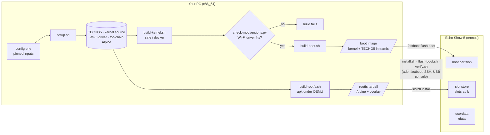
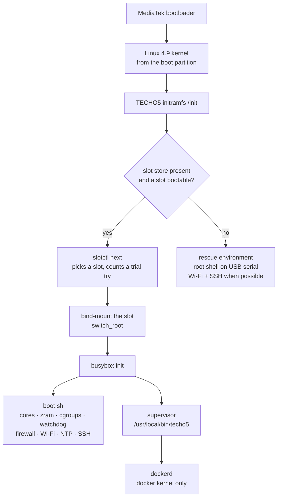
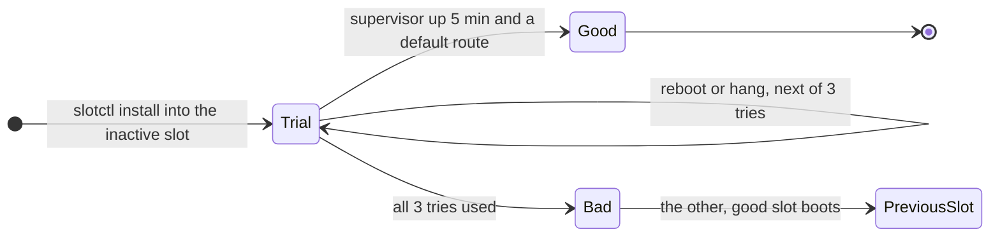
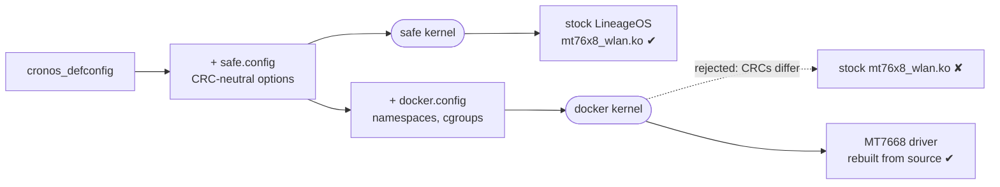
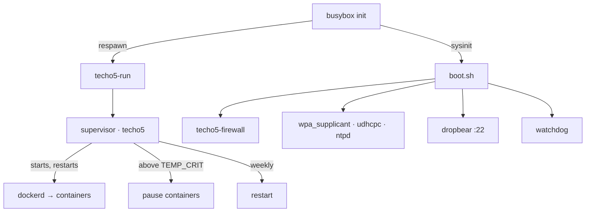

# echo-penguin 🐧

**Turn an Amazon Echo Show 5 (2nd gen) into a tiny, always-on Linux server.**

echo-penguin replaces Android on the Echo Show 5 2nd gen (codename `cronos`) with a headless
[Alpine Linux](https://alpinelinux.org/): you get Wi-Fi, SSH with keys only, Docker, and a system
built to run 24/7 without anyone touching it. It is built on top of the
[TECHO5](https://github.com/HuskerMinion/techo5) boot chain.

[](LICENSE)
-orange)


> [!WARNING]
> Installing **erases Android (LineageOS)** from the unit. It requires an Echo Show 5 2nd gen that
> is already unlocked and running LineageOS 18.1 (see [References](#references)). Everything here
> is at your own risk. This project is not affiliated with or endorsed by Amazon.

## Contents

- [What you get](#what-you-get)
- [Goals and non-goals](#goals-and-non-goals)
- [Quick start](#quick-start)
- [Using the Echo](#using-the-echo)
- [How it works](#how-it-works)
- [Maintenance](#maintenance)
- [Troubleshooting](#troubleshooting)
- [Repository layout](#repository-layout)
- [Contributing](#contributing)
- [References](#references)
- [License](#license)

## What you get

| | |
|---|---|
| **Hardware** | MediaTek MT8163, 4x Cortex-A53 up to 1.3 GHz, ~1 GB RAM (+480 MB zram swap), 7.3 GiB eMMC, MT7668 Wi-Fi (2.4/5 GHz) |
| **System** | Alpine Linux 3.24 (armv7 userland), busybox init, read-only root, state on `/data` |
| **Access** | Wi-Fi + SSH (Dropbear, **keys only**); a root console over USB as a fallback |
| **Containers** | Docker (overlay2, data on `/data/docker`) on the `docker` kernel |
| **Reliability** | hardware watchdog, temperature guard, weekly restart, rotated logs, A/B system slots with automatic rollback |
| **Security** | firewall closes everything on Wi-Fi except SSH and the ports you choose |
| **Screen** | kernel and boot messages on the built-in display (framebuffer console) |

Typical uses: a home lab node, a small self-hosted service, a Docker host for lightweight
containers, an always-on SSH jump box.

## Goals and non-goals

**Goals**

- Run plain Linux on the Echo Show 5 2nd gen, **without Android**.
- Be **headless and reachable**: Wi-Fi and SSH come up on every boot, with no screen interaction.
- Run **24/7 unattended**, and recover on its own from bad updates, hangs and overheating.
- Be **reproducible**: every input is pinned in [config.env](config.env), and the build refuses to
  produce an image that would boot without Wi-Fi.
- Keep a **way back** to LineageOS or Fire OS.

**Non-goals**

- What runs on top (your containers and services): that is up to you.
- Touchscreen UI, voice assistant, audio, camera or Bluetooth.
- Other Echo models. TECHO5 supports more devices; echo-penguin only targets `cronos`.

## Quick start

### 1. What you need

**The Echo**

- An Echo Show 5 **2nd gen** (2021, `cronos`), unlocked, rooted and running
  **LineageOS 18.1** (the XDA guides in [References](#references)).
- In LineageOS: Wi-Fi connected, **USB debugging** and **Rooted debugging** on.
- A USB cable to your PC.

**The PC** (Linux x86_64)

- `git`, `python3` with `brotli`, `make`, `gcc`, `bc`, `curl`, `debugfs` (e2fsprogs), `unshare`,
  Docker, `adb` and `fastboot`.
- QEMU user emulation for armv7, once per PC boot (package install scripts run inside the armv7
  rootfs):

  ```bash
  sudo apt install qemu-user-static binfmt-support            # permanent
  # or, without apt (lasts until the PC reboots):
  docker run --privileged --rm tonistiigi/binfmt:qemu-v9.2.2 --install arm
  ```

- The LineageOS zip `lineage-18.1-20260904-UNOFFICIAL-cronos.zip` (the vendor Wi-Fi module is read
  from it). Point `LINEAGE_ZIP=` at it; by default it is looked for in `../echo-show/`.
- An SSH key: `~/.ssh/techo5.pub`, else `~/.ssh/id_ed25519.pub`, or set `SSH_PUB=`.

No root is needed for the build.

### 2. Build

```bash
git clone <this repository> echo-penguin && cd echo-penguin
scripts/build-all.sh
```

This fetches every input at its pinned commit, builds both kernels, both boot images and the root
filesystem. Everything downloaded or generated goes to `../echo-penguin-build/` (override with
`PENGUIN_BUILD=`), never into the repository. The results are in `../echo-penguin-build/work/out/`.

### 3. Install

```bash
scripts/install.sh safe --dry-run     # checks everything, writes nothing
scripts/install.sh safe               # asks once before erasing LineageOS
```

The installer backs up the LineageOS boot image, flashes echo-penguin, creates the slot store,
installs the system into slot `a`, copies your SSH key and follows the first boot. Wi-Fi uses the
network LineageOS had saved (or pass `--wifi <network>`).

> [!TIP]
> Start with the **safe** kernel: it uses the stock Wi-Fi driver and is the lowest-risk first
> boot. Move to the **docker** kernel afterwards (step 5).

### 4. Verify

```bash
HOST=<echo-ip> scripts/verify.sh
```

Each check prints `PASS`, `FAIL` or `WARN`: key-only SSH, slot state, Wi-Fi, cores, memory, zram,
watchdog, temperature, Docker and closed ports. The checks that need time (24 h, 72 h) or hands on
the unit (power cut, rollback) are printed as a checklist at the end.

### 5. Enable Docker

```bash
HOST=<echo-ip> scripts/flash-boot.sh docker
```

If the new kernel does not come back on SSH within 5 minutes, the previous one is flashed back
automatically.

## Using the Echo

```bash
ssh -i ~/.ssh/techo5 root@<echo-ip>
```

| Command | What it does |
|---|---|
| `penguin status` | kernel, services, containers, temperature, memory, disk, slots |
| `penguin logs [supervisor\|docker\|boot\|firewall] [-f]` | show (or follow) a log |
| `penguin settings` | effective settings |
| `penguin set KEY VALUE` | change a setting (kept across updates) |
| `penguin firewall` | re-apply the firewall after changing `LAN_PORTS` or `DOCKER_LAN` |
| `penguin restart` | restart the supervisor (containers keep running) |
| `slotctl status` | which system slot is active, and its state |

**Settings.** Defaults live in [/etc/penguin/defaults.conf](rootfs/etc/penguin/defaults.conf);
your overrides go to `/data/penguin/settings.conf`. The most useful ones:

| Setting | Default | Meaning |
|---|---|---|
| `LAN_PORTS` | *(empty)* | extra TCP ports open on Wi-Fi, e.g. `"80 443"` |
| `DOCKER_LAN` | `0` | `1` lets containers' published ports be reached from Wi-Fi |
| `DOCKER` | `auto` | start Docker when the kernel supports it, or `off` |
| `BACKLIGHT` | `90` | screen brightness 0–255 (`0` = off) |
| `TEMP_CRIT` | `85` | °C at which running containers are paused |
| `WEEKLY_REBOOT_DAY` / `_HOUR` | `0` / `4` | weekly restart (Sunday 04:00); empty = never |

**Reaching a container.** Published ports are closed on Wi-Fi by default; use an SSH tunnel:

```bash
ssh -i ~/.ssh/techo5 -L 8080:localhost:8080 root@<echo-ip>   # then open http://localhost:8080
```

Or open them on the LAN: `penguin set DOCKER_LAN 1 && penguin firewall`.

> [!NOTE]
> The userland is 32-bit ARM, so Docker runs `linux/arm/v7` images. Keep RAM in mind: about
> 600 MB is available to your workloads.

## How it works

### The big picture



The repository holds only configuration, scripts and the files laid over Alpine. Upstream code is
fetched at pinned commits into `../echo-penguin-build/` and is never edited in place.

### Storage layout on the Echo

```
eMMC (mmcblk0)
├── boot   (p9)    kernel + TECHO5 initramfs         ← build-boot.sh, flashed by fastboot
├── system (p12)   /store: the slot store            ← was LineageOS
│   ├── active               which slot boots next (a | b)
│   ├── vendor/              the unit's own vendor tree (Wi-Fi driver, firmware)
│   └── slots/
│       ├── a/               a complete root filesystem   (a.state: good | trial N | bad)
│       └── b/               the other one: where the next update goes
└── userdata (p16) /data: everything that must survive updates
    ├── penguin/             settings.conf, logs/
    ├── docker/              images, containers, volumes
    ├── techo5-linux/        boot logs, crash records, SSH host key, Wi-Fi credentials
    └── misc/techo5/ssh/     authorized_keys
```

The running system is **read-only**. Anything that changes lives on `/data`, so a system slot can
be replaced wholesale without losing state.

### Boot sequence



Two names are kept on purpose for TECHO5 compatibility: the sysinit script stays at
`/etc/techo5/boot.sh`, and the supervisor is called `/usr/local/bin/techo5`, because TECHO5's
`slotctl`, slot trial and installer look for a process with that name.

### Safe updates: A/B slots with a trial



A new system never replaces the running one in place. It goes into the other slot and boots
**on trial**: it is only committed once the supervisor has run for five minutes *and* the network
has a default route ([trial.conf](rootfs/etc/techo5/trial.conf)). A slot that boots but leaves
the unit unreachable therefore rolls back by itself.

### Why there are two kernels

The Wi-Fi driver shipped with LineageOS (`mt76x8_wlan.ko`) is a binary built with
`CONFIG_MODVERSIONS`: the kernel only loads it if the checksums (CRCs) of every kernel symbol it
uses match. Docker needs options (`NAMESPACES`, `CGROUP_DEVICE`, `CGROUP_PIDS`, `BLK_CGROUP`,
`CPUSETS`, `POSIX_MQUEUE`) that change the layout of core kernel structures, and with it those
CRCs, so the stock driver is rejected.



| Kernel | Wi-Fi driver | Docker | Use it for |
|---|---|---|---|
| `safe` | stock LineageOS binary | no | the first install; a known-good fallback |
| `docker` | rebuilt from the same source LineageOS uses | yes | everyday use |

Every option in [kernel/safe.config](kernel/safe.config) was measured with
[scripts/bisect-crc.sh](scripts/bisect-crc.sh) to change no CRC. `build-kernel.sh` runs
[check-modversions.py](scripts/check-modversions.py) on the driver each variant will load and
**fails the build** if anything differs, so an image that would boot without Wi-Fi is never
produced. The same root filesystem works with both kernels; the supervisor only starts `dockerd`
when the kernel supports it.

The boot partition itself has no A/B slots, which is why
[flash-boot.sh](scripts/flash-boot.sh) watches for SSH after switching kernels and flashes the
previous image back if it does not return.

### What runs on the unit



- **Supervisor** ([techo5](rootfs/usr/local/bin/techo5)): keeps `dockerd` alive, pauses
  containers when the CPU is too hot and resumes them once it cools to `TEMP_WARN`, and handles
  the weekly restart. busybox init restarts the supervisor itself if it ever exits.
- **Firewall** ([techo5-firewall](rootfs/usr/local/sbin/techo5-firewall)): on Wi-Fi only SSH,
  `LAN_PORTS`, DHCP, ICMP and replies get in. Container ports are filtered in Docker's
  `DOCKER-USER` chain. If a rule fails, that address family is left open rather than locking you
  out. The kernel has no nftables, so `iptables` points to the legacy backend.
- **Watchdog**: if userspace hangs, the hardware watchdog restarts the unit.
- **SSH**: password logins are disabled; only keys in `/data/misc/techo5/ssh/authorized_keys`
  work.

## Maintenance

### Updating the system

```bash
scripts/build-rootfs.sh
scp ../echo-penguin-build/work/out/echo-penguin-rootfs-<v>.tar.gz root@<ip>:/data/techo5-linux/
ssh root@<ip> 'slotctl install /data/techo5-linux/echo-penguin-rootfs-<v>.tar.gz && reboot'
```

The update goes into the inactive slot on trial and rolls back on its own if it does not settle
(see [Safe updates](#safe-updates-ab-slots-with-a-trial)). Settings, logs and containers on
`/data` are kept.

### Switching kernels

```bash
HOST=<echo-ip> scripts/flash-boot.sh safe     # or docker
```

The unit reboots into fastboot over SSH, the image is flashed over USB, and the script waits up to
5 minutes for SSH; if it does not return, the previous image is flashed back. Keep the USB cable
connected for the whole run. Switching to `docker` requires a rootfs built after
`build-kernel.sh docker` (it carries the rebuilt driver); the script checks this first.

### The way back

| To go back to | How |
|---|---|
| the `safe` kernel | `flash-boot.sh safe`, or `fastboot flash boot ../echo-penguin-build/work/out/echo-penguin-boot-safe.img` |
| the previous system slot | automatic on a failed trial; by hand: `slotctl rollback` |
| LineageOS | `fastboot flash boot ../echo-penguin-build/techo5/inputs/boot-lineage-18.1-20260904-cronos.img`, then flash the LineageOS zip in TWRP (recovery is untouched). See TECHO5's `docs/install.md`, "To go back to LineageOS". |
| Fire OS (factory) | the TECHO5 installer's backup of the small partitions in `techo5/backups/<serial>/partitions/` (`p9-boot.img` is the original boot; checksums in `SHA256SUMS`) |

## Troubleshooting

**The unit has no network.** Connect USB: the unit exposes a root console on `/dev/ttyACM*`
(USB gadget `1d6b:0104`). Run commands on it from the PC:

```bash
ECHO_SERIAL=<serial> scripts/console.py 'penguin status'
```

From that console, `rebootto bootloader` reboots into fastboot. To copy a small file over it, use
`scripts/console-push.py --chunk 1024 <file> <remote path>`.

**The installer stopped at "slot store".** The unit waits in the rescue environment (RESCUE on
screen). Finish the install over USB:

```bash
ECHO_SERIAL=<serial> scripts/finish-install.sh
```

**The USB console is busy or does not answer.** ModemManager on the PC may be probing the port;
stop it (`sudo systemctl stop ModemManager`). Make sure your user is in the `dialout` group.

**Commands not found over non-interactive SSH.** `penguin`, `slotctl` and `rebootto` live in
`/usr/local/sbin`, which a non-interactive SSH session may not have on its `PATH`. Use the full path
or `ssh root@<ip> 'PATH=/usr/local/sbin:$PATH penguin status'`.

**The rescue environment rebooted by itself.** Without network, rescue reboots after 15 minutes so
an unattended unit never stays stuck. On the USB console, `touch /tmp/stay` keeps it up.

**Something else.** `penguin logs boot`, `penguin logs supervisor` and `slotctl status` usually
tell the story; include them when you [open an issue](#reporting-a-problem).

## Repository layout

```
config.env              pinned inputs: TECHO5, kernel, Wi-Fi driver, toolchain, paths
kernel/
  safe.config           options added to cronos_defconfig in both kernels (CRC-neutral, measured)
  docker.config         what the docker kernel adds (changes CRCs: needs the rebuilt driver)
  patches/              kernel patches (GPL-2.0)
rootfs-packages.txt     Alpine packages in the system image
rootfs/                 files laid over Alpine and TECHO5's rootfs
  etc/techo5/           boot.sh, shutdown.sh, trial.conf
  etc/penguin/          default settings
  usr/local/bin/techo5  the supervisor
  usr/local/sbin/       penguin, techo5-firewall, techo5-run, rebootto
scripts/                run on the PC
  setup.sh build-all.sh build-kernel.sh build-boot.sh build-rootfs.sh mkrootfs.sh
  install.sh finish-install.sh flash-boot.sh verify.sh
  console.py console-push.py                  USB console helpers
  check-modversions.py bisect-crc.sh sdat2img.py   kernel/driver diagnostics
```

Outside the repository, in `../echo-penguin-build/`:

```
techo5/       TECHO5 at the pinned commit, and its inputs
work/         kernel tree, toolchain, Wi-Fi driver, extracted LineageOS, staging
work/out/     the finished boot images, kernels and rootfs tarballs
```

## Contributing

Contributions are welcome: bug reports, test results on your own unit, documentation and code.

### Ways to help

- **Test and report.** Run `scripts/verify.sh` on your unit and share the result, especially the
  long-running checks (24 h and 72 h uptime, power cut, Wi-Fi outage, rollback).
- **Fix a known rough edge.** For example, `verify.sh` gives false warnings on CPU cores (MediaTek
  hotplug) and counts console ramoops records as crashes.
- **Improve the docs.** If a step confused you, it will confuse the next person too.

### Development workflow

1. Fork the repository and create a branch: `git checkout -b fix/short-description`.
2. Make your change. Keep it focused: one topic per pull request.
3. Check it:
   - `bash -n scripts/*.sh` (and [ShellCheck](https://www.shellcheck.net/) if you have it);
   - rebuild what you touched (`scripts/build-kernel.sh`, `build-boot.sh` or `build-rootfs.sh`);
   - if it changes what runs on the unit, test it on hardware and run `scripts/verify.sh`.
4. Commit with [Conventional Commits](https://www.conventionalcommits.org/) and open a pull
   request that says what you changed, why, and how you tested it.

### Conventions

- **English** everywhere: code, comments, script output, docs, commit messages.
- **Commit messages**: `type(scope): summary`, for example `feat(rootfs): …`, `fix(scripts): …`,
  `docs: …`, `build: …`, `chore: …`. Explain the *why* in the body. When the change builds on
  someone else's work, credit it with a `Refs: <url>` trailer.
- **Match the surrounding code.** Every script starts with a comment saying what it does, how to
  call it and why; keep that up to date.
- **Code on the unit is busybox `ash`**, not bash. Nothing in `boot.sh` may stop the boot: steps
  are best effort and logged.
- **Pin every input** in [config.env](config.env). No floating branches or `latest`.
- **Never edit upstream checkouts.** Fixes to TECHO5 are applied at build time and must fail
  loudly when upstream changes (see `techo5_lib` in [scripts/lib.sh](scripts/lib.sh)).
- **Kernel options**: an option added to `safe.config` must be proven CRC-neutral with
  `bisect-crc.sh`; anything else belongs in `docker.config`.
- **No personal data.** Do not commit device serial numbers, IP addresses, Wi-Fi names, keys or
  backups. Scripts take them from arguments or environment variables (`ECHO_SERIAL`, `HOST`,
  `SSH_PUB`).

### Reporting a problem

Open an issue with:

- what you did and what happened;
- the kernel variant (`safe` or `docker`) and the rootfs version (`cat /etc/techo5-release`);
- the output of `scripts/verify.sh`, `slotctl status` and the relevant `penguin logs`.

Remove your unit's serial number, IP addresses and network names from anything you paste.

## References

echo-penguin stands on the work of these projects; versions and commits are pinned in
[config.env](config.env).

- **[TECHO5](https://github.com/HuskerMinion/techo5)** (MIT) — the boot chain, rescue initramfs,
  slot store (`slotctl`), installer (`tools/install-show.py`), USB console library
  (`tools/techo5lib.py`) and image packer (`tools/linux/mkimage.py`), used from a pinned checkout
  that is never edited ([scripts/lib.sh](scripts/lib.sh) applies one checked fix to
  `techo5-lib.sh` at build time). [scripts/mkrootfs.sh](scripts/mkrootfs.sh) and
  [rootfs/etc/techo5/boot.sh](rootfs/etc/techo5/boot.sh) are trimmed forks of its
  `tools/linux/mkrootfs.sh` and `etc/techo5/boot.sh`;
  [rootfs/usr/local/sbin/rebootto](rootfs/usr/local/sbin/rebootto) is a Python port of its
  `cmd/rebootto`.
- **[amazon-oss/android_kernel_amazon_mt8163](https://github.com/amazon-oss/android_kernel_amazon_mt8163)**
  (GPL-2.0) — the LineageOS kernel for `cronos` that both kernels are built from, and that
  [kernel/patches/](kernel/patches/) applies to.
- **[amazon-oss/android_kernel_amazon_mt76x8-wifi](https://github.com/amazon-oss/android_kernel_amazon_mt76x8-wifi)**
  — the MediaTek MT7668 Wi-Fi driver source, rebuilt for the docker kernel.
- **LineageOS 18.1 for the Echo Show 5 2nd gen** —
  [unofficial build (XDA)](https://xdaforums.com/t/rom-unofficial-11-cronos-lineageos-18-1-for-the-amazon-echo-show-5-2021.4772598/)
  and the [unlock, root and TWRP guide (XDA)](https://xdaforums.com/t/unlock-root-twrp-unbrick-amazon-echo-show-5-2nd-gen-2021-cronos.4772596/)
  that installing echo-penguin presupposes.
- **[Alpine Linux](https://alpinelinux.org/)** — the minirootfs, `apk` and the packages in
  [rootfs-packages.txt](rootfs-packages.txt); see also the Alpine wiki on
  [Docker](https://wiki.alpinelinux.org/wiki/Docker).
- **[Arm GNU Toolchain 8.3-2019.03](https://developer.arm.com/downloads/-/gnu-a)** — the aarch64
  cross compiler this 4.9 kernel tree builds with.
- **[Moby `check-config.sh`](https://github.com/moby/moby/blob/master/contrib/check-config.sh)** —
  the list of kernel options Docker needs, behind [kernel/docker.config](kernel/docker.config).
- **[tonistiigi/binfmt](https://github.com/tonistiigi/binfmt)** — QEMU user emulation for building
  the armv7 rootfs on an x86_64 host.
- **[sdat2img](https://github.com/xpirt/sdat2img)** by xpirt — the reference for the Android
  `transfer.list` format; [scripts/sdat2img.py](scripts/sdat2img.py) is a minimal reimplementation.

## License

[MIT](LICENSE), except [kernel/patches/](kernel/patches/), which modifies the Linux kernel and is
GPL-2.0. See [NOTICE](NOTICE) for the code derived from TECHO5 and for what the built images contain.
